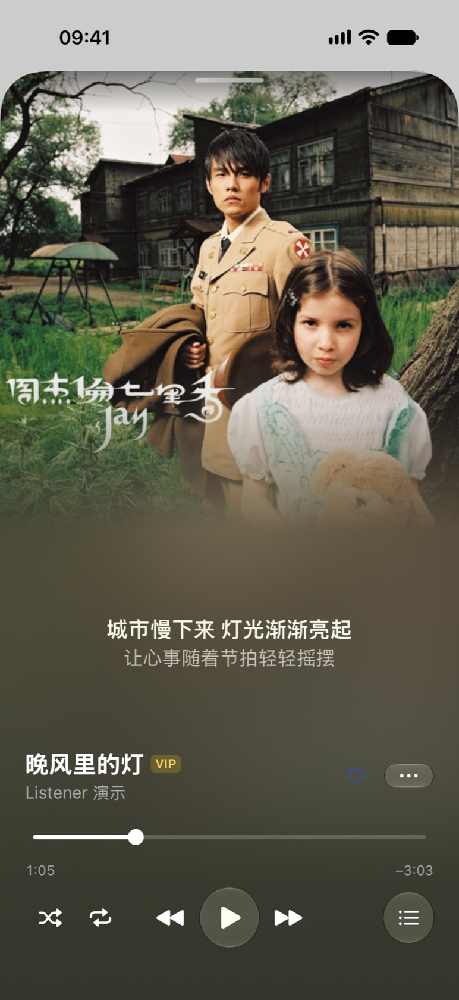

# Listener

Listener 是一款接入 QQ 音乐的轻量播放器，支持 macOS 和 iPhone。macOS 版使用 Tauri 2、Vue 3 和 AMLL 歌词渲染。iPhone 版使用原生 SwiftUI、系统 Liquid Glass 和 AVPlayer。两端共享负责 QQ 音乐接口和本地资料库的 Rust 核心。

[下载 macOS DMG 或 iPhone IPA](https://github.com/Timekeeperxxx/Listener/releases/latest) · [0.6.0 更新说明](docs/releases/0.6.0.md) · [构建 iPhone 版](#原生-iphone-项目)

## 界面截图

**桌面布局 · 推荐**


**桌面布局 · 同步歌词**


| iPhone · 正在播放 | iPhone · 同步歌词 |
| :---: | :---: |
|  |  |

桌面截图来自网页演示，iPhone 截图来自使用测试数据的模拟器。截图中的推荐和歌词用于展示界面。

## 功能

- macOS 支持扫码连接 QQ 音乐。iPhone 提供 QQ 授权、二维码和手机号登录入口，验证方式由 QQ 决定。登录凭据保存在各自设备的系统钥匙串。
- 推荐页包含每日 30 首、个性化歌曲、推荐歌单和 QQ 音乐排行榜。最近播放可以从「我的收藏」查看。
- 读取“我喜欢”、自建及收藏歌单；创建、重命名、删除自己的 QQ 歌单，增删歌曲和红心收藏。
- 统一搜索歌曲、歌手、专辑及公开歌单，分页读取真实结果，保存最近 20 条搜索。
- 浏览线上歌手和专辑目录，查看头像、封面、简介、歌曲与发行专辑。歌手歌曲可按热度或发行时间排序，播放全部和随机播放会先读取完整曲目。
- 关注歌手和收藏专辑，提供“我的收藏”入口；与 QQ 音乐的关注歌手、收藏专辑同步，本地 SQLite 仅缓存当前账户的同步结果。
- 队列支持下一首播放、追加、移除、排序、随机及循环。按账户保存队列与播放位置，重新打开后暂停等待续播。
- 在歌曲结束前 20 秒准备下一首的播放地址和音频缓冲，减少切歌等待；可关闭。
- 支持 MP3、FLAC、Hi-Res 与下载管理，优先播放已下载的音频。实际权限和音质由 QQ 音乐决定。
- 两端支持逐字与逐行歌词、译文、音译和间奏圆点。手动浏览时歌词变清晰，当前句保留逐字高亮。播放中停止浏览后，等待至少 2.5 秒，随下一句恢复跟随，最迟 5 秒。恢复跟随时同步恢复虚化。
- 点击虚化的歌词可先展开清晰歌词，iPhone 同时显示进度条。再点清晰的歌词可以跳到该句。iPhone 的封面页还会显示当前句和下一句。
- 歌词字号、行距、译文、音译偏好持久保存；支持全局及每首歌独立的时间微调。
- 菜单栏播放控制、可配置全局快捷键、关窗后台播放、媒体键、迷你播放器及桌面歌词。
- macOS 的「设置 → 外观」支持跟随系统、浅色和深色。跟随系统时，系统外观切换会立即反映在 Listener 中。
- 定时停止、歌词缓存容量限制及清理、本机存储用量、应用内检查更新与签名校验。

## 开发

桌面开发需要 macOS 12.3+、Node.js 22.12+、Rust 1.90+ 和 Xcode Command Line Tools。当前发布的 macOS 安装包适用于 Apple Silicon。

```sh
npm ci
npm run mac:dev
```

独立 HTML 演示：

```sh
npm run demo
# 打开 http://127.0.0.1:4173/demo.html
```

网页中的线上目录和统一搜索读取 QQ 公开资料；个人歌单、播放、歌词及收藏写入是演示交互。账户登录、真实播放、全局快捷键和更新安装需要桌面应用。运行时无需 Node.js 服务。

## 构建与发布

本地开发构建：

```sh
npm run mac:build:unsigned
```

发布构建需要与应用公钥匹配的更新签名私钥：

```sh
# 可以提供密钥文件路径，也可以通过受保护的环境变量提供密钥内容
export TAURI_SIGNING_PRIVATE_KEY=/path/to/signing.key
export TAURI_SIGNING_PRIVATE_KEY_PASSWORD=''
npm run mac:build
npm run release:manifest
```

未设置变量时，构建脚本查找 `~/.config/listener/updates/signing.key`。私钥不在仓库中。构建产物：

- `src-tauri/target/release/bundle/macos/Listener.app`
- 同目录下的 `Listener.app.tar.gz`、`.sig` 和 `latest.json`
- `src-tauri/target/release/bundle/dmg/Listener_版本_aarch64.dmg` 及 SHA-256 文件

将 macOS 更新包、签名、清单、DMG 和 iPhone IPA 上传到同一个 `v版本` GitHub Release。macOS 客户端从最新正式 Release 读取清单，下载后校验签名及签名绑定的版本。构建架构改变时需给清单脚本传入正确架构，并通过 `LISTENER_BUNDLE_DIR` 指定对应产物目录。

DMG 由 `hdiutil` 创建和验证，避免构建期间调用 Finder。当前应用为本地 ad-hoc 签名，尚未做 Apple Developer ID 公证；更新包签名与 Apple 公证是两件不同的事。

自动检查模板见 [docs/ci/check.yml](docs/ci/check.yml)。当前 GitHub OAuth 授权不含 `workflow` 权限，因此原有 Actions 文件保留；将模板启用为工作流需要具备相应权限的 GitHub 授权。

## 原生 iPhone 项目

[ListenerNative.xcodeproj](ios/ListenerNative.xcodeproj) 是独立的 SwiftUI 项目，使用系统 Liquid Glass 标签栏、迷你播放器和 AVPlayer。Xcode 的 **Build Rust Core** 阶段从 `src-tauri` 构建静态库，复用 QQ 音乐接口、系统钥匙串和 SQLite 资料库。QQ 自己提供的授权及安全验证页面仍由系统浏览组件显示。

```sh
rustup target add aarch64-apple-ios
npm run ios:build
```

真机包输出到 `src-tauri/target/aarch64-apple-ios/release/ios-native/Listener_版本_iOS_Native.ipa`。它沿用原 iPhone 版的应用标识，使用同一签名安装时可继续使用原数据。可用 iLoader 签名安装，也可以在 Xcode 的 ListenerNative target 中选择自己的开发团队运行。

构建需要完整 Xcode 和 iOS 26 或更新的 SDK，最低部署版本为 iOS 26.0。连接并解锁 iPhone，在本机 [iLoader](https://iloader.app/) 选择设备和 **Import IPA**，导入安装包后签名安装。

模拟器构建需要 `rustup target add aarch64-apple-ios-sim`，然后运行 `npm run ios:build -- --simulator --debug`。模拟器的 App 和账户数据与真机分开。

## 操作

| 操作 | 快捷键 |
|---|---|
| 播放 / 暂停 | 空格 |
| 前后跳转 5 秒 | ← / → |
| 展开 / 关闭歌词 | L |
| 聚焦搜索 | ⌘F / ⌘K |
| 打开设置 | ⌘, |
| 全局播放 / 暂停 | ⌃⌥空格 |
| 全局上一首 / 下一首 | ⌃⌥← / ⌃⌥→ |
| 全局显示主窗口 | ⌃⌥M |

全局快捷键可在设置中修改。默认关窗后继续播放，通过菜单栏或 Dock 打开主窗口；⌘Q 完全退出。歌词正偏移使歌词提前，负偏移使歌词延后。恢复播放不会自动开始，也不会复用有期限的旧音源地址。

## 结构与验证

`src` 包含 Vue 界面、Pinia 状态、歌词 Worker 和独立演示。`ios` 包含原生 SwiftUI 项目。`src-tauri/src` 包含两端共享的 QQ 音乐接入、登录、SQLite 和下载，以及 macOS 的桌面能力和更新。歌词读取实时音频时钟，迷你窗口和桌面歌词共用主窗口的音频状态。

```sh
npm test
npm run build
npm run build:demo
cargo test --manifest-path src-tauri/Cargo.toml --lib
cargo clippy --manifest-path src-tauri/Cargo.toml --all-targets -- -D warnings
```

QQ 接口错误、会话失效和权益不足会明确显示，不以演示数据代替。会员/地区、登录到期续期与云端写入的所有组合仍需对应账户验收。较旧 macOS 的音频、材质和全局快捷键需要对应设备验证。下载不提供断点续传。

## 许可

AGPL-3.0-only，与 [AMLL](https://github.com/Steve-xmh/applemusic-like-lyrics) 一致。字体和其他依赖说明见 [THIRD_PARTY_NOTICES.md](THIRD_PARTY_NOTICES.md)。

协议接入参考 [QQMusicApi](https://github.com/l-1124/QQMusicApi) 和 QQ 音乐实际响应，写请求格式参考 [qmweb-sign](https://github.com/jixunmoe/qmweb-sign)。框架能力见 [Tauri Updater](https://v2.tauri.app/plugin/updater/)、[系统托盘](https://v2.tauri.app/learn/system-tray/) 和 [全局快捷键](https://v2.tauri.app/plugin/global-shortcut/)。
