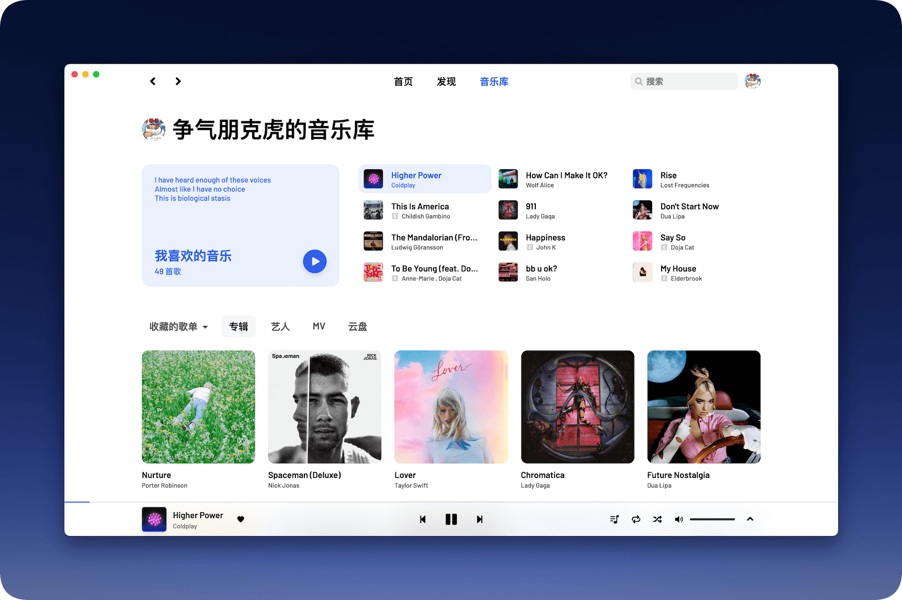
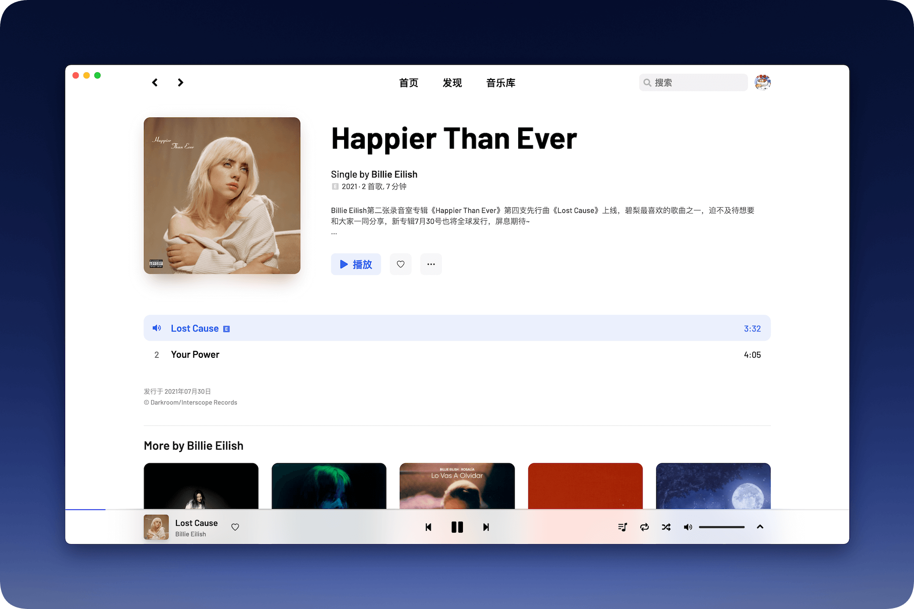
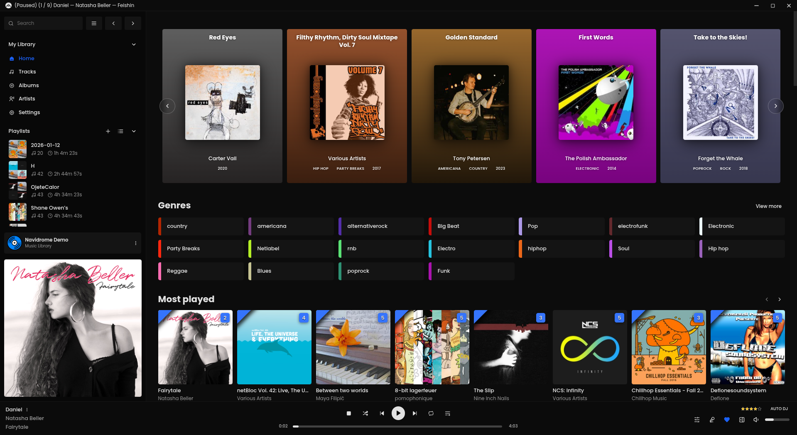
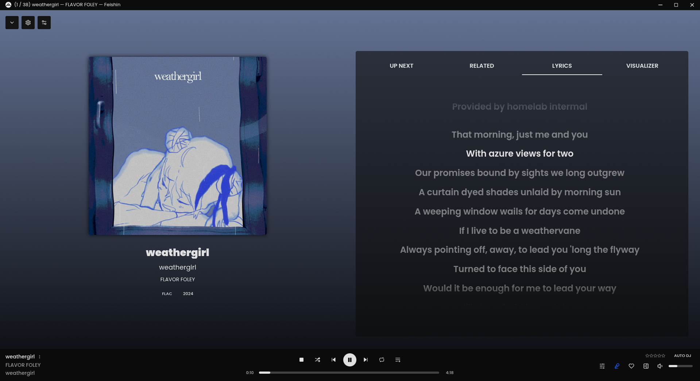
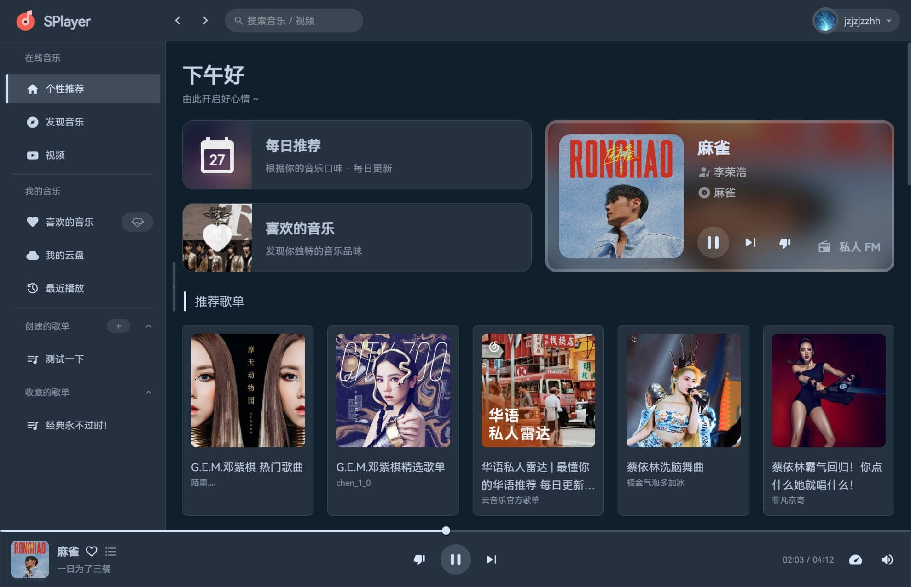

# Listener 播放器 UI 学习与改版建议

研究日期：2026-11-04。本文是界面研究与改版建议，尚未修改应用 UI。

## 1. 先说结论

建议下一版以 **YesPlayMusic 的浅色音乐库层级、SPlayer 的独立歌词页、macOS 的玻璃导航与控制层** 为主要方向，借鉴 Feishin 的桌面布局和背景分层方式。

上一版的设计判断有偏差：字号偏小、文字偏淡，品牌和装饰占据了过多注意力。用户每天需要看清的歌名、歌手、播放进度，反而显得弱。歌词页又保留了侧栏、搜索栏和醒目的白色播放条，画面缺乏统一感。

这次学习后，最重要的四点是：

1. **音乐内容要先被看见。** 封面和歌名决定页面重心，正文需要足够清楚。
2. **浏览和看歌词需要各自的布局。** 找歌时保留导航，进入歌词后让封面、歌词与控制占据整个舞台。
3. **玻璃材质需要明确用途。** 用它表达导航和控制悬浮在内容上方的关系，并为文字提供稳定的背景。
4. **简洁需要做减法。** 精简文案、装饰与次要入口，同时保留必要的信息和操作。

## 2. 实际看了哪些项目

下表中的截图均来自项目自己的 GitHub 仓库，已下载原图、逐张查看，并固定到具体提交，避免后续仓库更新造成图文错位。

| 项目 | 本次查看的证据 | 最值得借鉴的部分 | 版本说明 |
| --- | --- | --- | --- |
| [YesPlayMusic](https://github.com/qier222/YesPlayMusic) | 音乐库、专辑页截图；`CoverRow.vue` | 文字层级、封面网格、内容与操作的次序 | 经典版，README 标记为维护状态；本文不将这些截图当作 2.0 Alpha 界面。[版本来源][yes-readme] |
| [Feishin](https://github.com/jeffvli/feishin) | 首页、全屏播放截图；全屏布局样式 | 稳定的桌面分区、播放模式切换、背景与前景分层 | 固定提交 `155e5621` 的仓库素材 |
| [SPlayer](https://github.com/SPlayer-Dev/SPlayer) | 主页面、播放页面截图 | 歌词页的完整构图、当前歌词的视觉重心 | 经典仓库已于 2026-07-17 归档；与 SPlayer-Next 区分。[仓库状态][splayer-repo] |
| [AMLL Player](https://github.com/amll-dev/amll-player) | 歌词页容器、底部播放条样式 | 独立歌词层、进入与退出、浏览播放条的隐藏方式 | 作为代码参考；本次在线演示未成功渲染，未据此评价真实动效 |

已完成的研究步骤：

| 步骤 | 状态与范围 |
| --- | --- |
| 保存 Listener 当前界面 | 已完成：最近播放、歌词页的原生窗口截图 |
| 查看 GitHub 参考界面 | 已完成：3 个项目、6 张仓库原图 |
| 核对部分实现 | 已完成：YesPlayMusic 封面行、Feishin 全屏布局、AMLL 页面与播放条样式 |
| 对照 Listener 提出调整 | 已完成：问题、尺寸建议、优先级与验收项见下文 |
| 实际交互和性能比较 | 未进行：没有安装这些播放器逐项测试，静态截图无法证明动画流畅度和资源占用 |

## 3. Listener 目前具体哪里失衡

### 音乐列表

（本机截图未随源码发布。）

来源：本机 Listener 实际窗口，原始截图 2560 × 1682。

| 观察到的现象 | 原因与影响 | 建议 |
| --- | --- | --- |
| 大标题、英文眉题、说明文案比歌曲更醒目 | 同一个“最近播放”在顶部和正文重复出现，用户视线先经过介绍区 | 保留简短页标题、数量和播放操作，尽早进入歌曲列表 |
| 歌名、歌手显得小而轻 | 当前 CSS 中歌名为 11px，歌手为 9px；查找歌曲需要读细小文字 | 歌名提高到 14px，歌手提高到 12px，并增加前景与背景的明暗差 |
| 大面积粉紫灰文字 | 导航、内容、次要信息的颜色过于接近，层级主要依赖大小 | 使用中性深色正文、清楚的次要灰色；强调色集中在播放与选中状态 |
| 侧栏品牌与底部标语占有较强存在感 | 重复装饰挤占常用导航的空间 | 缩小品牌区，去掉日常页面里的标语，账号入口改为紧凑形式 |
| 底部播放条的边框和白色面板很醒目，内部文字却偏弱 | 材质的存在感超过播放信息 | 减弱外框和高光，增加歌名、进度、主要按钮的清晰度 |

字体数值来自 [Listener 列表样式](../../src/style.css#L155)；播放条现为 87px 高，见 [播放条样式](../../src/style.css#L166)。这些是源码事实；表中的视觉判断是结合截图作出的设计评价。

截图当时只有 5 条播放历史，下方留白有真实的数据原因。历史少时可以保留自然空白；需要减少的是页头与装饰的开销。

### 歌词页

（本机截图未随源码发布。）

来源：本机实际窗口；截图停留在歌曲署名文字状态，用于观察页面框架。

最突出的问题是三部分互相争夺注意力：左侧明亮导航、上方搜索栏、下方白色播放条。中间的封面和歌词被包在浏览页面中，进入歌词后没有形成完整的播放场景。封面信息与底部小封面信息也重复出现。

这张静态截图不能单独证明逐字同步或整首歌词的可读性存在问题。后续应分别检查正在唱的行、译文、间奏、手动滚动状态；当前能明确判断的是布局与材质缺乏统一。

## 4. 从 GitHub 界面中学到了什么

### 4.1 YesPlayMusic：封面、标题、次要信息各有位置

来源：[仓库音乐库原图][yes-library]，固定提交 `5d5fa23b`。

**实际观察：** 页面通过封面、深色标题和较浅的歌手文字形成层级。封面之间的间距一致，标题紧跟封面；底部播放条的位置稳定。音乐库上部虽有大块内容，但其中放的是收藏歌曲及可播放内容。

**代码印证：** `CoverRow.vue` 中封面标题默认 16px、字重 600，次要信息 12px；文字与封面之间留 8px，并限制标题行数。默认网格为 5 列，横向间距 24px。它把字号、行数和间距作为一套规则。[源码][yes-cover-code]

**用于 Listener：** 首页直接展示“继续播放”“我的歌单”等真实音乐内容；歌单卡片使用统一的封面比例、标题字号和文本行数。列表和卡片可以有不同密度，但同类元素要遵守同一组规则。

来源：[仓库专辑页原图][yes-album]。

专辑页的阅读次序很清楚：封面与名称 → 歌手和简介 → 播放操作 → 歌曲。Listener 的歌单详情可以采用这个次序，再按窗口大小压缩简介和头部高度。参考图里的超大标题、顶部导航形式需要结合我们的窗口尺寸重新设计。

**我的收获：** 清爽感来自稳定的排版和对齐；歌名仍然需要足够强的存在感。

### 4.2 Feishin：稳定的浏览分区，完整的播放场景

来源：[仓库首页原图][feishin-library]，固定提交 `155e5621`。

**实际观察：** 左侧承担资料库与歌单导航，中间展示音乐，底部负责播放。用户切换内容时仍能找到常用区域。它的信息量也明显更多，直接搬过来会超过 Listener 当前需要的复杂度。

**用于 Listener：** 保留稳定的“侧栏—内容—播放控制”结构；当前阶段围绕 QQ 歌单、收藏、最近播放和歌词组织入口。服务器管理、流派墙、多种可视化等不进入此次简洁改版。

来源：[仓库全屏播放原图][feishin-fullscreen]。

**代码印证：** 全屏播放器使用覆盖区域的独立容器，并将封面背景、模糊遮罩与内容分层；封面区域还根据屏幕方向调整比例。[源码][feishin-layout-code]

**用于 Listener：** 把背景色彩、遮罩、歌词、控件拆成清楚的层。歌词区域需要宽度约束和稳定底色，避免背景亮度变化直接干扰文字。

参考代码中还有控件在非悬停时降低透明度的处理。Listener 的主要播放按钮应保持可见，键盘聚焦时也需要明确提示。这里借鉴的是布局与分层，具体透明度要重新验证。

**我的收获：** 全屏播放值得单独设计；它的背景、内容与控制需要一起组织。

### 4.3 SPlayer：歌词成为页面主角

来源：[仓库主页原图][splayer-library]，固定提交 `40d9ec60`。

**实际观察：** 主页把推荐、收藏和歌单分成不同区域，导航归组清楚。但卡片、描边和功能入口较多，Listener 应取其组织方式，再精简到现有需求。

来源：[仓库播放页原图][splayer-lyrics]。

播放页最值得学：浏览侧栏和搜索栏退出画面，封面与歌词占据主要区域，播放控制融入同一个背景；当前行在截图中有明确的亮度和字重优势。画面色彩也与封面相呼应。

**用于 Listener：** 点击封面或歌词按钮后，进入独立的沉浸歌词页。保留明确的返回按钮和 `Esc` 返回路径，隐藏浏览侧栏与搜索栏，播放控制统一成一组。原文为主，译文和音译作为可切换的辅助信息。

这张图片只能说明构图和某一帧的层级，不能据此判断滚动、逐字动画或操作手感。

**我的收获：** 进入歌词页后，界面应把空间和注意力交给正在播放的内容。

### 4.4 AMLL Player：歌词组件外，还需要完整的页面状态

本次补充阅读了两个样式文件：

- [歌词页容器][amll-page-code]：歌词页覆盖整个视口，通过打开状态控制位置、圆角与交互。
- [底部播放条][amll-bar-code]：播放条可以移出视图并停止接收点击；队列面板设置了宽高上限。

这说明歌词页、浏览播放条、队列需要协调显示状态。Listener 已经接入 AMLL，下一步应改善它所处的页面：进入歌词时收起浏览框架，退出后回到原来的歌单与滚动位置，打开队列时保持歌词主体可辨认。

本次 AMLL Player 在线演示未成功渲染，因此这里的结论仅来自代码阅读，未声称实际体验了它的动画。

## 5. 苹果风格和液态玻璃怎么落实

Apple 的材料指南将 Liquid Glass 用于浮在内容上方的导航与控制，强调层级和可读性。[Apple 材料指南](https://developer.apple.com/design/human-interface-guidelines/materials)

结合这些参考，Listener 建议按用途分配材质：

| 区域 | 建议处理 | 目的 |
| --- | --- | --- |
| 音乐库正文、歌曲行 | 稳定的浅色内容底面，清楚的深色文字 | 让长时间浏览和找歌更轻松 |
| 侧栏、工具栏 | 克制的半透明材质，清楚的选中状态 | 区分导航与内容 |
| 浮动播放控制、队列面板 | 适量玻璃材质、轻边缘高光 | 表达其浮在内容上方的关系 |
| 歌词背景 | 封面取色或模糊封面，加稳定遮罩 | 提供氛围，同时控制文字所在区域的亮度 |
| 歌词与主要按钮 | 清楚的前景色，有限的强调色 | 保持当前内容和必要操作可辨认 |

“苹果风格”在本项目里应具体表现为：系统字体、准确对齐、克制配色、清楚的选中与焦点状态、自然的页面切换，以及适量的玻璃控制层。

## 6. 建议采用的尺寸与视觉规则

以下是 **Listener 下一版的设计起点**，需要在真实窗口中调整；这些数值并非参考项目的统一规范。

| 项目 | 建议值 |
| --- | --- |
| 正文 / 歌曲名 | 14px，歌名可用中等字重 |
| 歌手 / 专辑等次要信息 | 12–13px，清楚的中性灰色 |
| 导航文字 | 13–14px |
| 辅助标签 / 时间 | 11–12px |
| 页面标题 | 24–28px |
| 歌词原文 | 宽窗口约 32–40px，随可用宽高调整 |
| 侧栏宽度 | 200–220px，重点压缩品牌区与上下装饰 |
| 顶部工具栏 | 52–56px，当前为 74px |
| 浏览模式播放条 | 72–80px，主要按钮与时间保持清楚 |
| 歌曲行高 | 52–56px；封面约 36–40px |
| 间距 | 以 8、12、16、24、32px 为主，统一同类间距 |
| 圆角 | 内容图片约 8–12px；悬浮控制约 16–20px |
| 色彩 | 浅灰白底、深色正文、单一红色强调；歌词页由封面提供色彩 |

在宽窗口中，歌词页采用左侧封面和歌曲信息、右侧歌词的两栏布局；空间不足时先缩小封面与次要信息，再调整列布局，始终给原文足够宽度。

轻量要求继续约束实现：沿用现有 Tauri、Vue 和 AMLL；背景模糊集中在少量层上，隐藏歌词页时应停止不必要的动画工作。原生玻璃与网页半透明层的叠加效果，需要在 macOS 实机检查。

## 7. 改版顺序与验收方式

| 顺序 | 具体改什么 | 验收重点 |
| --- | --- | --- |
| 第一轮：文字与浏览结构 | 放大正文，统一颜色和间距；精简品牌、页头与介绍卡片；首页展示真实音乐内容 | 能快速找到歌单和歌名，常用信息清楚，短列表自然留白 |
| 第二轮：歌词页 | 独立页面构图，收起导航与搜索，统一播放控制；处理译文、音译与队列 | 进入与退出自然，当前歌词突出，只有一套主要播放控制 |
| 第三轮：材质与动效 | 调整玻璃、背景遮罩、高光与过渡；落实减少动态和减少透明度设置 | 深浅封面下均可读，缩放窗口无挤压，动画和资源占用符合轻量目标 |

改版后至少需要检查：

- 在 1280 × 840 和 960 × 680 窗口下，导航、长歌名、播放控制没有重叠或裁切。
- 用真实 QQ 歌单检查长标题、无封面、歌曲加载中及失败状态。
- 用中文、英文、日文歌词检查原文、译文、音译的优先级，以及无逐字数据时的呈现。
- 分别检查当前行、间奏、手动滚动、点击跳转、队列展开和返回歌单；保持播放与位置连续。
- 对普通文字以至少 4.5:1、大号文字以至少 3:1 为对比度验收基准；玻璃和动态背景需检查实际合成后的颜色。[W3C 对比度说明](https://www.w3.org/WAI/WCAG22/Understanding/contrast-minimum.html)
- 检查键盘焦点、`Esc`、空格与系统减少动态设置；隐藏歌词页后检查动画是否停止，实际记录 CPU/GPU 占用。

这些是后续验收项，本轮尚未执行。

## 8. 本轮交付与证据边界

已完成 GitHub 截图与部分源码研究，保存了参考原图、本机截图和来源清单，并形成上述改版建议。本轮没有修改业务代码，也没有重建安装包。

本文中的仓库截图属于作者提供的静态示例，可能早于所固定提交的实际运行界面；它们用于学习布局与视觉组织。动效、交互、可访问性和性能仍需要在后续实现中实测。

全部素材的原始来源、固定提交、尺寸与 SHA-256 校验值见 [素材来源清单](sources.json)。

[yes-readme]: https://github.com/qier222/YesPlayMusic/blob/5d5fa23b7429c82a9932bbc2c9f6036403c5757b/README.md
[yes-library]: https://github.com/qier222/YesPlayMusic/blob/5d5fa23b7429c82a9932bbc2c9f6036403c5757b/images/library.png
[yes-album]: https://github.com/qier222/YesPlayMusic/blob/5d5fa23b7429c82a9932bbc2c9f6036403c5757b/images/album.png
[yes-cover-code]: https://github.com/qier222/YesPlayMusic/blob/5d5fa23b7429c82a9932bbc2c9f6036403c5757b/src/components/CoverRow.vue
[feishin-library]: https://github.com/jeffvli/feishin/blob/155e562138f39adaa985a01bc974936925518b46/media/preview_home.png
[feishin-fullscreen]: https://github.com/jeffvli/feishin/blob/155e562138f39adaa985a01bc974936925518b46/media/preview_full_screen_player.png
[feishin-layout-code]: https://github.com/jeffvli/feishin/blob/155e562138f39adaa985a01bc974936925518b46/src/renderer/features/player/components/full-screen-player.module.css
[splayer-repo]: https://github.com/SPlayer-Dev/SPlayer
[splayer-library]: https://github.com/SPlayer-Dev/SPlayer/blob/40d9ec606cc1e323c964ffea7bf0ab02f137e93b/screenshots/SPlayer%20-%20%E4%B8%BB%E9%A1%B5%E9%9D%A2.jpg
[splayer-lyrics]: https://github.com/SPlayer-Dev/SPlayer/blob/40d9ec606cc1e323c964ffea7bf0ab02f137e93b/screenshots/SPlayer%20-%20%E6%92%AD%E6%94%BE%E9%A1%B5%E9%9D%A2.jpg
[amll-page-code]: https://github.com/amll-dev/amll-player/blob/90c1b909b7a6b0ca7b7f468c343868fbfd026883/packages/player/src/components/AMLLWrapper/index.module.css
[amll-bar-code]: https://github.com/amll-dev/amll-player/blob/90c1b909b7a6b0ca7b7f468c343868fbfd026883/packages/player/src/components/NowPlayingBar/index.module.css
